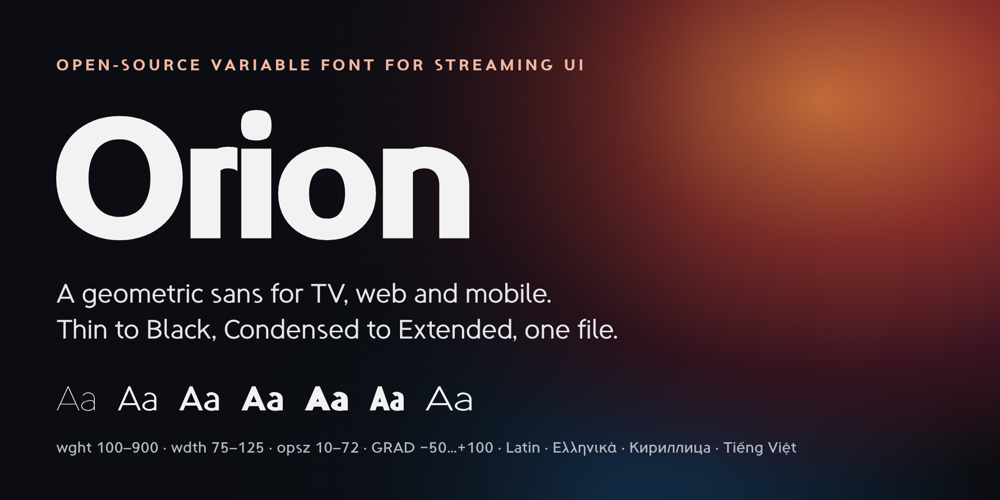
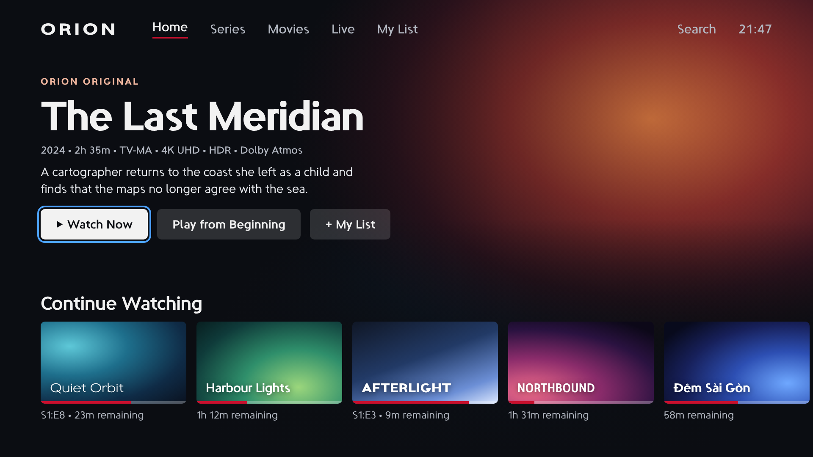
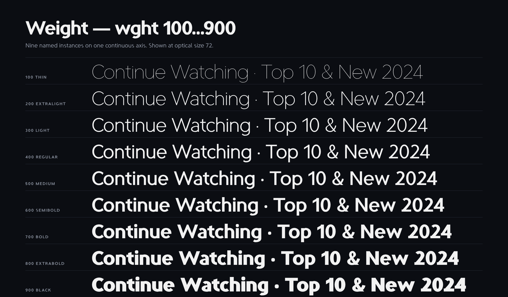
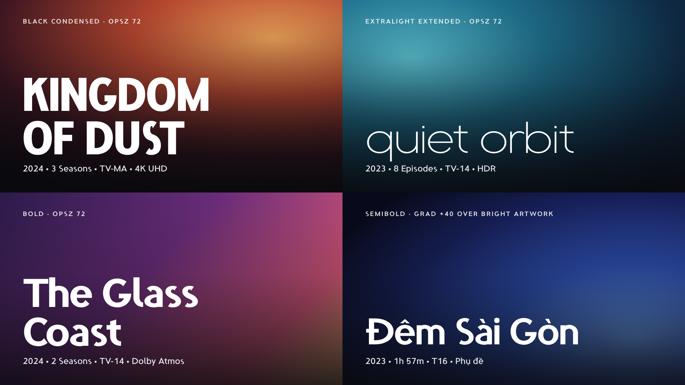
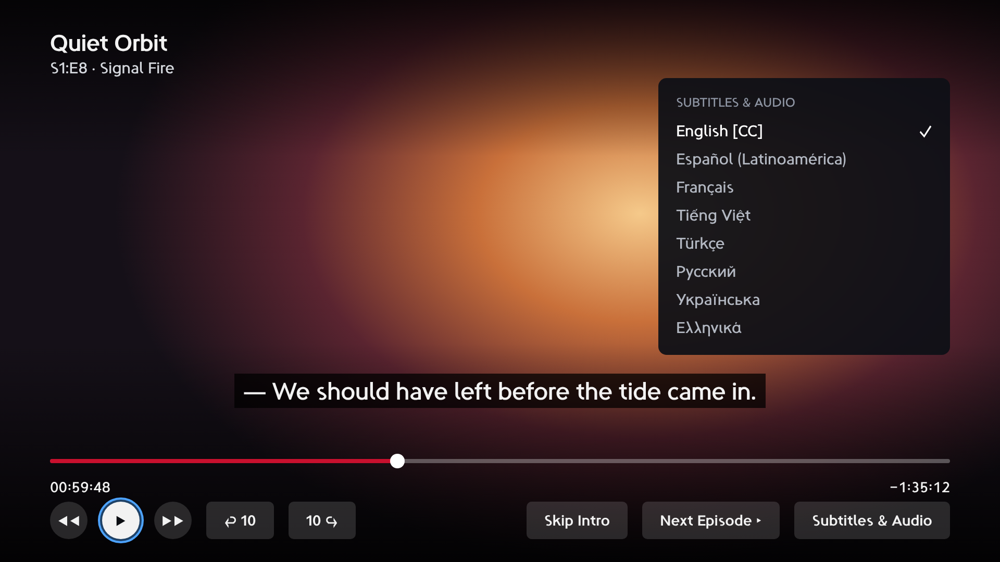
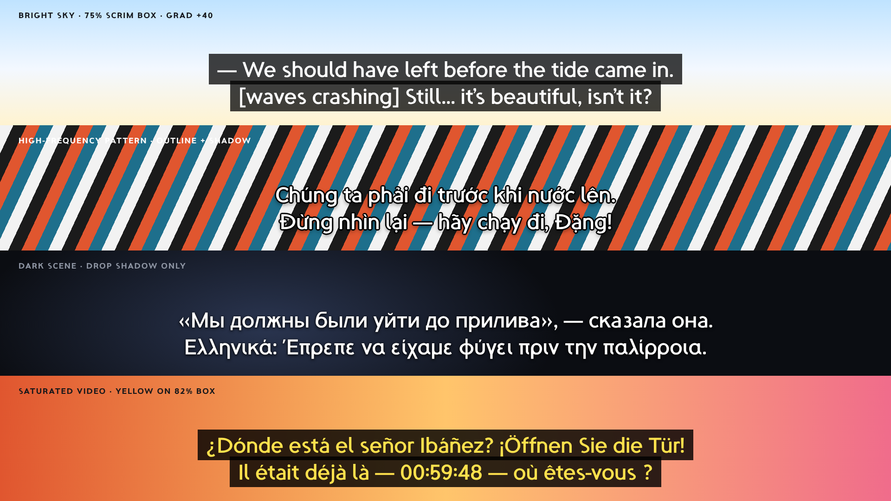
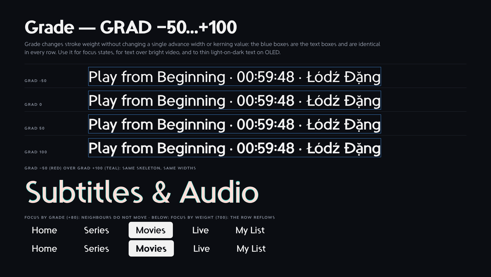
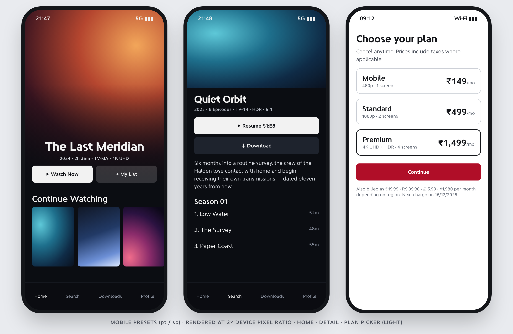

<p align="center">
  
</p>

<h1 align="center">Orion</h1>

<p align="center">
  <b>A free, open-source variable sans-serif for streaming, TV and app interfaces.</b><br>
  Geometric like Gotham, built for the screen like Netflix Sans, engineered with four variable axes.
</p>

<p align="center">
  
  
  
  
  
  
</p>

<p align="center">
  <a href="#download">Download</a> ·
  <a href="#use-it">Use it</a> ·
  <a href="#specimens">Specimens</a> ·
  <a href="#orion-as-an-alternative-to-gotham-netflix-sans-inter-and-roboto-flex">Compare</a> ·
  <a href="#status-and-limits">Status</a> ·
  <a href="docs/OVERVIEW.md">Docs</a>
</p>

---

## Why Orion

Orion is a typeface for the 10-foot interface: hero titles, content rails, metadata, playback controls and subtitles, read from a sofa. It also scales down to phones and up to marketing headlines.

- **One file, every style.** Thin to Black, Condensed to Extended, caption to display.
- **Grade axis for focus states.** Make focused text heavier without changing its width, so rows never reflow under D-pad navigation.
- **Made to be told apart.** `I`, `l` and `1` have three different shapes; `0` is clearly narrower than `O`; a slashed zero is one feature away.
- **Interface numerals.** Tabular figures, and a colon that centres itself between digits for clocks like `00:59:48`.
- **Free for commercial use.** SIL Open Font License 1.1: embed it in apps, sites and devices.
- **Open sources.** The whole family is generated by a parametric Python program that ships in this repo, along with the UFO masters and the test suite.

<p align="center">
  
</p>

## At a glance

| | |
|---|---|
| **Styles** | 27 named instances: 9 weights × Normal, Condensed, Extended |
| **Variable axes** | Weight `wght` 100–900 · Width `wdth` 75–125 · Optical size `opsz` 10–72 · Grade `GRAD` −50…+100 |
| **Glyphs** | 899 glyphs, 774 characters |
| **Scripts** | Latin, Vietnamese, Greek (monotonic), Cyrillic |
| **Languages** | 41 checked complete, including English, Spanish, French, German, Italian, Portuguese, Dutch, Polish, Czech, Slovak, Hungarian, Romanian, Turkish, Vietnamese, Greek, Russian, Ukrainian, Bulgarian and Serbian |
| **OpenType features** | `kern` `mark` `mkmk` `ccmp` `locl` `case` `calt` `tnum` `pnum` `zero` `frac` `numr` `dnom` `sups` `subs` `sinf` `ordn` `ss01` `ss02` `ss03` |
| **Formats** | Variable TTF and WOFF2, static TTF, OTF and WOFF2, unicode-range subsets |
| **Size** | 308 KB for the full variable WOFF2; 135 KB for the Latin subset |
| **License** | [SIL Open Font License 1.1](OFL.txt) |

## Download

| You need | Get |
|---|---|
| Everything | **[Download ZIP](https://github.com/EliteArrow/orion-font-family/archive/refs/heads/main.zip)** |
| Variable font for apps | [`fonts/variable/Orion-VF.ttf`](fonts/variable/Orion-VF.ttf) |
| Variable font for the web | [`fonts/variable/Orion-VF.woff2`](fonts/variable/Orion-VF.woff2) |
| Desktop fonts (Figma, Sketch, Adobe) | [`fonts/static-otf/`](fonts/static-otf) |
| Static TTF: Orion, Orion Display, Orion Condensed | [`fonts/static/`](fonts/static) |
| Static WOFF2 | [`fonts/webfonts/`](fonts/webfonts) |
| Script subsets | [`fonts/subsets/`](fonts/subsets) |

## Use it

<details open>
<summary><b>Web (CSS)</b></summary>

```css
@font-face {
  font-family: 'Orion';
  src: url('fonts/variable/Orion-VF.woff2') format('woff2');
  font-weight: 100 900;
  font-stretch: 75% 125%;
  font-display: swap;
}

body      { font-family: 'Orion', system-ui, sans-serif; font-optical-sizing: auto; }
.title    { font-weight: 700; }
.rail     { font-weight: 500; font-stretch: 85%; }                  /* condensed for dense rows */
.focused  { font-variation-settings: 'GRAD' 80; }                   /* heavier, same width */
.timer    { font-variant-numeric: tabular-nums; }
```

A ready-made stylesheet with a static fallback and type presets for TV, desktop, tablet and mobile is in [`integration/css/orion.css`](integration/css/orion.css). You can also load it from a CDN that mirrors GitHub, for example jsDelivr:

```html
<link rel="stylesheet" href="https://cdn.jsdelivr.net/gh/EliteArrow/orion-font-family@main/integration/css/orion.css">
```
</details>

<details>
<summary><b>Android, Android TV, Google TV, Fire TV (Jetpack Compose)</b></summary>

Copy `fonts/variable/Orion-VF.ttf` to `res/font/orion_vf.ttf`.

```kotlin
val Orion = FontFamily(
    Font(R.font.orion_vf, weight = FontWeight.SemiBold,
         variationSettings = FontVariation.Settings(
             FontVariation.weight(600), FontVariation.width(100f),
             FontVariation.Setting("opsz", 36f), FontVariation.grade(0)))
)
```

Presets and the static fallback for API levels below 26: [`integration/android/`](integration/android).
</details>

<details>
<summary><b>iOS, iPadOS, tvOS (Swift)</b></summary>

Add `Orion-VF.ttf` to the target and to `UIAppFonts`, then use the helper in [`integration/ios/OrionFont.swift`](integration/ios/OrionFont.swift):

```swift
label.font = Orion.font(size: 44, wght: 600, opsz: 44, grad: 0)
Text("Continue Watching").orion(OrionTv.headlineM)
```
</details>

<details>
<summary><b>Samsung Tizen and LG webOS</b></summary>

Use the web CSS. Recent sets load the variable font; older engines fall back to the static family automatically. See [`integration/tv-platforms/`](integration/tv-platforms) for the support matrix.
</details>

<details>
<summary><b>Roku (SceneGraph)</b></summary>

Roku loads packaged static files:

```xml
<Label text="Continue Watching">
  <Font role="font" uri="pkg:/fonts/Orion-SemiBold.ttf" size="44" />
</Label>
```

More in [`integration/tv-platforms/roku/`](integration/tv-platforms/roku).
</details>

<details>
<summary><b>React</b></summary>

```tsx
import { OrionText } from './integration/react/OrionText';

<OrionText token="titleL" grade={focused ? 80 : 0}>Harbour Lights</OrionText>
```
</details>

## Specimens

Every image below is rendered from the font files in this repository.

| | |
|---|---|
|  |  |
| **Nine weights**, one axis | **Display styles** from Condensed Black to Extended Light |
|  |  |
| **Playback UI** with tabular timers | **Subtitles** in Latin, Vietnamese, Cyrillic and Greek |
|  |  |
| **Grade axis**: weight changes, width does not | **Mobile** |

More: [character set](specimens/glyph-sheets/character-set.png) · [numerals and symbols](specimens/glyph-sheets/numerals-symbols-punctuation.png) · [OpenType features](specimens/glyph-sheets/opentype-features.png) · [width](specimens/variable-axis/width.png) · [optical size](specimens/variable-axis/optical-size.png) · [TV type scale](specimens/typography-scale/type-scale-tv.png) · [multilingual](specimens/typography-scale/multilingual.png) · [card grid](specimens/ott-tv/card-grid.png) · [detail page](specimens/ott-tv/detail-synopsis.png) · [light theme](specimens/ott-tv/tv-home-bright.png)

To try the axes yourself, clone the repo and open [`specimens/html/tester.html`](specimens/html/tester.html) in a browser.

## Orion as an alternative to Gotham, Netflix Sans, Inter and Roboto Flex

If you are looking for a **free Gotham alternative**, an **open-source font similar to Netflix Sans**, or a **variable font for an OTT, streaming or smart-TV app**, this is where Orion sits. The numbers are measured from Orion and from licensed copies of each family, in units per 1000 em at the regular weight.

| | **Orion** | Gotham Book | Netflix Sans | Inter | Roboto Flex |
|---|---:|---:|---:|---:|---:|
| Cap height | **700** | 700 | 696 | 728 | 711 |
| x-height | **522** | 517 | 512 | 546 | 514 |
| Capital stem | **88** | 79 | 95 | 93 | 94 |
| Width of `O` | **692** | 714 | 688 | 646 | 601 |
| Mean lowercase advance | **522** | 566 | 516 | 536 | 495 |
| License | **OFL, free** | Commercial | Proprietary to Netflix | OFL, free | OFL, free |
| Variable axes | **wght, wdth, opsz, GRAD** | — | — | wght, opsz | 13 axes |

- **Compared with Gotham:** the same cap height and nearly the same x-height and round widths, so headlines have a similar geometric presence. Orion is spaced about 8 % tighter, a little darker at regular weight, and adds a tailed `l`, a flagged `1` and a narrow `0` for interface legibility.
- **Compared with Netflix Sans:** very close in overall width and colour (mean lowercase advance 522 against 516), with a slightly taller x-height. Netflix Sans is not licensed for use outside Netflix; Orion is free to embed.
- **Compared with Inter:** Orion has rounder bowls (`O` is 7 % wider) and a lower x-height, so it reads less like a system UI font and more like a brand typeface.
- **Compared with Roboto Flex:** the same idea of weight, width, optical size and grade in one file, in a wider, more geometric design with a smaller axis range.

Orion is an original design. It was not derived from, and is not affiliated with or endorsed by, any of these typefaces or their owners. It will not match any of them glyph for glyph, and the names above are trademarks of their respective owners, used only for comparison.

## Status and limits

Orion 1.000 is a first public release. Please read this before shipping it to viewers.

- **Generated, not hand-drawn.** The outlines come from a parametric program and have not been reviewed by a professional type designer. The heaviest weights of `S s 3 5` are the least refined shapes.
- **Tested in software only.** Rendering is verified in Chromium, FreeType and HarfBuzz. It has not been tested on physical TVs, Apple platforms, Windows, Tizen, webOS or Roku devices.
- **No italics**, no ligatures, and no Arabic, Hebrew, Indic, Thai or CJK. A fallback stack is in [docs/UNICODE-COVERAGE.md](docs/UNICODE-COVERAGE.md).
- **The name.** Other typefaces named “Orion” exist, and no trademark clearance has been done for this one.

The full list is in [docs/RELEASE-NOTES.md](docs/RELEASE-NOTES.md). Test results, including every warning, are in [docs/QA-REPORT.md](docs/QA-REPORT.md): 1,022 checks pass with 8 warnings and no failures, and the FontBakery universal profile reports no failures.

## Repository layout

```
fonts/         variable, static (TTF, OTF, WOFF2) and subset font files
sources/       UFO masters, designspace, features, and the parametric generator
integration/   CSS, React, Android, iOS/tvOS, Tizen, webOS and Roku samples, plus type-scale tokens
specimens/     rendered specimens and the HTML pages behind them
qa/            test suites, reports and visual-regression baselines
docs/          design system, specifications, axes, coverage, accessibility, QA, release notes
```

## Build from source

```bash
pip install -r sources/build-scripts/requirements.txt
python3 sources/build-scripts/build.py all     # fonts
python3 qa/run_all.py                          # tests
python3 specimens/src/build_specimens.py       # specimens (needs Chrome or Chromium)
```

How the generator is organised and how to add a glyph: [sources/build-scripts/README.md](sources/build-scripts/README.md).

## Documentation

[Overview](docs/OVERVIEW.md) · [Design system and type presets](docs/DESIGN-SYSTEM.md) · [Font specifications](docs/FONT-SPECIFICATIONS.md) · [Variable axes](docs/VARIABLE-AXES.md) · [Unicode coverage](docs/UNICODE-COVERAGE.md) · [Accessibility](docs/ACCESSIBILITY.md) · [QA report](docs/QA-REPORT.md) · [Release notes](docs/RELEASE-NOTES.md)

## FAQ

**Is Orion free for commercial use?**
Yes. The fonts are under the SIL Open Font License 1.1, which allows use, embedding and redistribution in commercial products. The fonts cannot be sold on their own. See [OFL.txt](OFL.txt) and [LICENSE.md](LICENSE.md).

**Is Orion a drop-in replacement for Gotham or Netflix Sans?**
No. It has similar proportions and a similar geometric tone, but different letterforms and spacing, so layouts will shift slightly and it will not look identical.

**Can I use Orion in a smart-TV or streaming app?**
That is what it was designed for, and integration samples for Android TV, Fire TV, tvOS, Tizen, webOS and Roku are included. It has not yet been verified on physical devices, so test on your targets first.

**Does Orion support Vietnamese, Greek and Cyrillic?**
Yes: full Vietnamese, monotonic Greek, and Cyrillic for Russian, Ukrainian, Bulgarian, Serbian, Belarusian and Macedonian.

**Does it have italics?**
Not yet.

## Contributing

Issues and pull requests are welcome, especially device test reports, glyph corrections and new language coverage. See [CONTRIBUTING.md](CONTRIBUTING.md).

## License

Fonts and font sources: [SIL Open Font License 1.1](OFL.txt). Build, test and integration code: MIT. Documentation and specimen images: CC BY 4.0. Details and provenance: [LICENSE.md](LICENSE.md).

<sub>Keywords: free Gotham alternative, open-source Gotham alternative, font similar to Netflix Sans, Netflix Sans alternative, OTT font, streaming UI font, smart TV font, 10-foot UI typography, Android TV font, tvOS font, Roku font, Tizen font, webOS font, geometric sans-serif, variable font with grade axis, optical size, subtitle font, free commercial-use font, SIL OFL.</sub>
