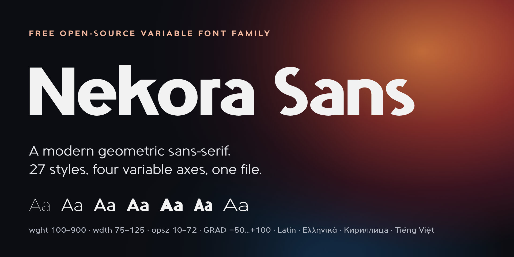
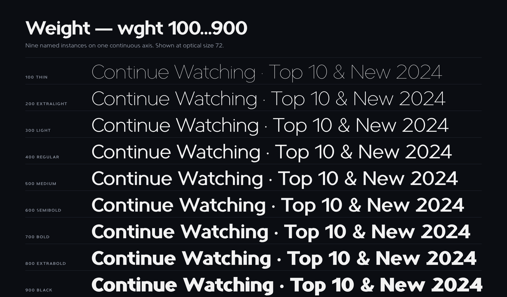
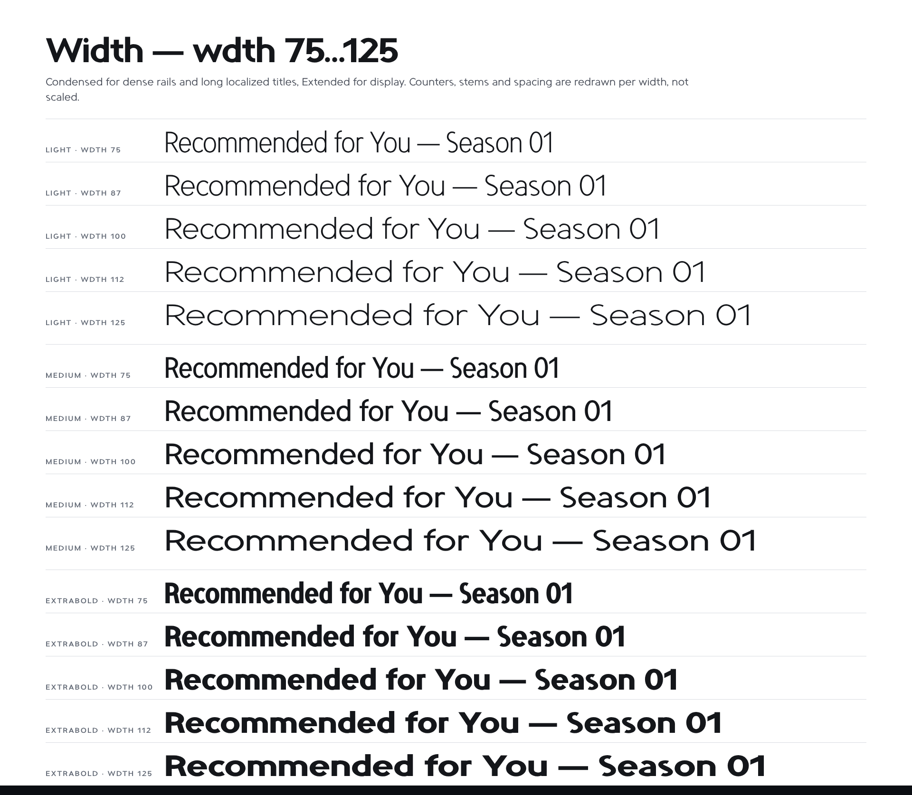
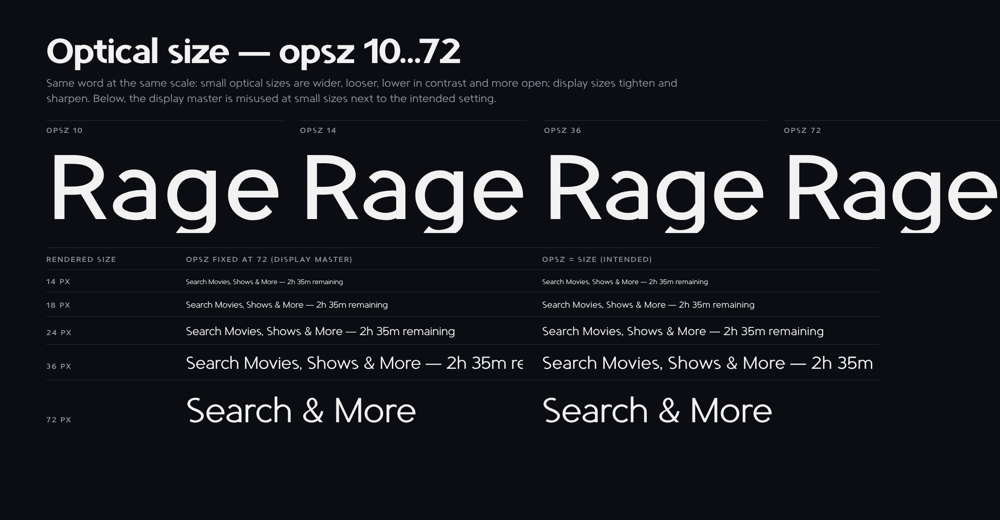
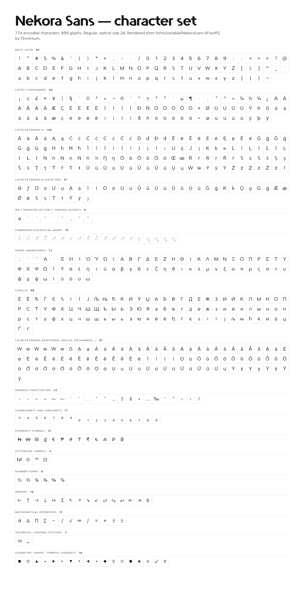
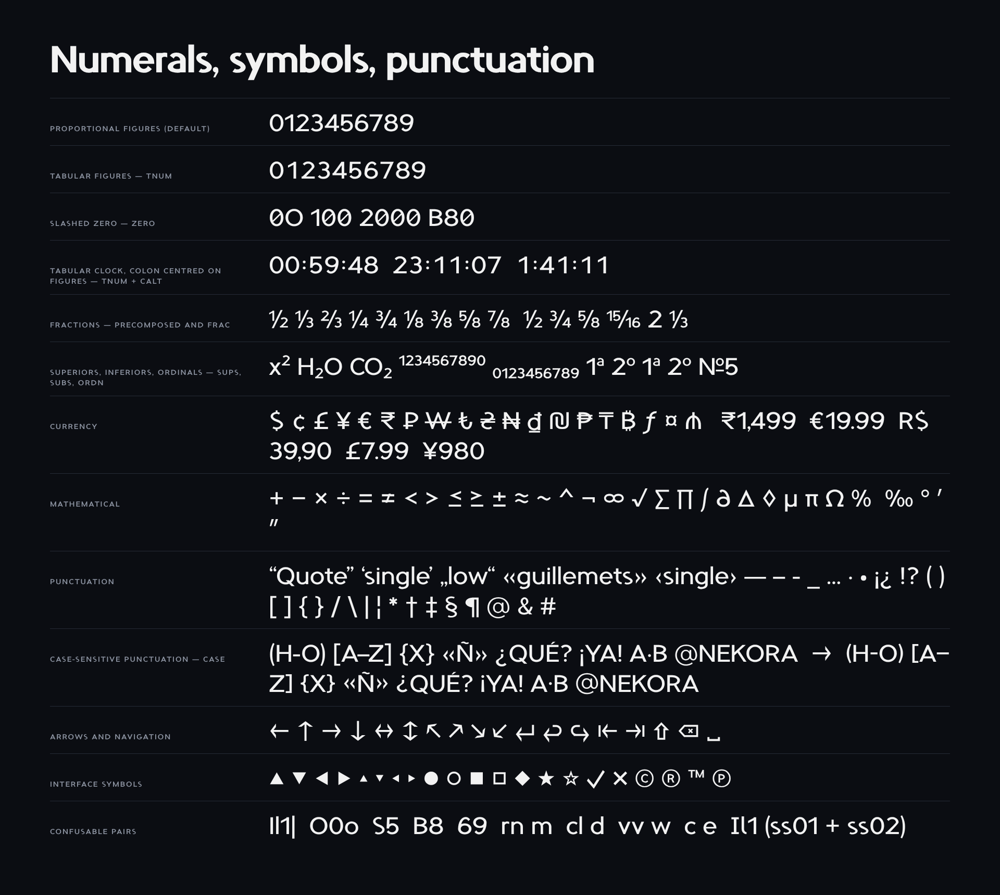

<p align="center">
  
</p>

<h1 align="center">Nekora Sans</h1>

<p align="center">
  <b>A free, open-source geometric sans-serif font family.</b><br>
  27 styles from Thin to Black and Condensed to Extended, plus a variable font with four axes.
</p>

<p align="center">
  <a href="https://github.com/EliteArrow/nekora-sans-font-family/raw/main/NekoraSans-Fonts.zip">
    
  </a>
</p>

<p align="center">
  
  
  
  
  
  
</p>

---

## Download and install

**[⬇ Download NekoraSans-Fonts.zip](https://github.com/EliteArrow/nekora-sans-font-family/raw/main/NekoraSans-Fonts.zip)** — everything in one file.

1. Unzip it.
2. **Mac:** open the `static-otf` folder, select all the files, double-click, then choose *Install*.
   **Windows:** open the `static` → `Nekora Sans` folder, select all the files, right-click, then choose *Install*.
3. Pick **Nekora Sans** in your app's font menu.

| In the ZIP | What it is for |
|---|---|
| `static-otf/` | Desktop fonts for Mac, Figma, Sketch, Adobe apps (9 weights) |
| `static/NekoraSans/` | Desktop fonts for Windows and Office; app embedding (9 weights, TTF) |
| `static/NekoraSansDisplay/` | A tighter cut for large headlines (9 weights) |
| `static/NekoraSansCondensed/` | A narrow cut for tight spaces (9 weights) |
| `variable/` | One variable font with every style: `NekoraSans-VF.ttf` and `NekoraSans-VF.woff2` |
| `webfonts/` | WOFF2 files for websites |
| `OFL.txt` | The licence |

Individual files are also in the [`fonts`](fonts) folder of this repository.

## About Nekora Sans

Nekora Sans is a modern geometric sans-serif: round bowls, even strokes and a tall x-height, with humanist touches that keep text easy to read. It works for branding, headlines, interfaces, apps, presentations and long-form text on screen.

- **A full family.** Nine weights in three widths, and a display cut for large sizes.
- **Variable.** Weight, width, optical size and grade in a single file.
- **Clean, conventional forms.** Plain geometric letters and wide, calm numerals, with optional alternates for a serifed `I`, a tailed `l` and a single-storey `a`.
- **Useful numerals.** Proportional and tabular figures, slashed zero, fractions, superscripts and subscripts.
- **Multilingual.** Latin, Vietnamese, Greek and Cyrillic.
- **Free for commercial use** under the SIL Open Font License.

<p align="center">
  
</p>

## Styles

| Weight | Value | Normal | Condensed | Extended |
|---|---:|:---:|:---:|:---:|
| Thin | 100 | ✓ | ✓ | ✓ |
| ExtraLight | 200 | ✓ | ✓ | ✓ |
| Light | 300 | ✓ | ✓ | ✓ |
| Regular | 400 | ✓ | ✓ | ✓ |
| Medium | 500 | ✓ | ✓ | ✓ |
| SemiBold | 600 | ✓ | ✓ | ✓ |
| Bold | 700 | ✓ | ✓ | ✓ |
| ExtraBold | 800 | ✓ | ✓ | ✓ |
| Black | 900 | ✓ | ✓ | ✓ |

All 27 styles are named instances of the variable font. Static files are provided for Normal, Condensed and Display; Extended is available through the variable font.

<p align="center">
  
</p>

## Variable axes

| Axis | Tag | Range | Default | What it does |
|---|---|---|---:|---|
| Weight | `wght` | 100–900 | 400 | Thin to Black |
| Width | `wdth` | 75–125 | 100 | Condensed to Extended |
| Optical size | `opsz` | 10–72 | 14 | Looser and sturdier when small, tighter and sharper when large |
| Grade | `GRAD` | −50 to +100 | 0 | Makes strokes lighter or heavier without changing the width of the text |

| | |
|---|---|
|  |  |

## Character set

899 glyphs covering 774 characters, checked complete for 41 languages: English, Spanish, French, German, Italian, Portuguese, Dutch, Polish, Czech, Slovak, Hungarian, Romanian, Turkish, Vietnamese, Greek, Russian, Ukrainian, Bulgarian, Serbian, Catalan, Danish, Norwegian, Swedish, Finnish, Icelandic, Estonian, Latvian, Lithuanian, Croatian, Slovenian, Albanian, Maltese, Indonesian, Malay, Filipino, Swahili, Welsh, Irish, Azerbaijani, Belarusian and Macedonian.

<p align="center">
  
</p>

<p align="center">
  
</p>

## OpenType features

| Feature | Tag |
|---|---|
| Kerning | `kern` |
| Tabular and proportional figures | `tnum`, `pnum` |
| Slashed zero | `zero` |
| Fractions | `frac` |
| Superscripts, subscripts, ordinals | `sups`, `subs`, `sinf`, `numr`, `dnom`, `ordn` |
| Capital-height punctuation | `case` |
| Colon raised between figures | `calt` |
| Localised forms (Romanian, Catalan, Serbian, Macedonian) | `locl` |
| Combining accents | `ccmp`, `mark`, `mkmk` |
| Serifed capital I | `ss01` |
| l with tail | `ss02` |
| Single-storey a | `ss03` |

## Use on a website

Copy the `fonts` and `css` folders to your site and link the stylesheet:

```html
<link rel="stylesheet" href="css/nekora-sans.css">
<style>
  body { font-family: var(--nekora-sans); }
  h1   { font-weight: 800; }
</style>
```

Or write the rule yourself:

```css
@font-face {
  font-family: 'Nekora Sans';
  src: url('fonts/variable/NekoraSans-VF.woff2') format('woff2');
  font-weight: 100 900;
  font-stretch: 75% 125%;
  font-display: swap;
}

body     { font-family: 'Nekora Sans', system-ui, sans-serif; font-optical-sizing: auto; }
.narrow  { font-stretch: 75%; }
.heavier { font-variation-settings: 'GRAD' 80; }
.numbers { font-variant-numeric: tabular-nums; }
```

The variable web font is 308 KB. Smaller per-script files that load on demand are in [`fonts/subsets`](fonts/subsets) with their own stylesheet.

## Nekora Sans as an alternative to Gotham, Netflix Sans, Inter and Roboto Flex

If you are looking for a **free Gotham alternative** or an **open-source font similar to Netflix Sans**, this is where Nekora Sans sits. The numbers are measured from Nekora Sans and from licensed copies of each family, in units per 1000 em at the regular weight.

| | **Nekora Sans** | Gotham Book | Netflix Sans | Inter | Roboto Flex |
|---|---:|---:|---:|---:|---:|
| Cap height | **700** | 700 | 696 | 728 | 711 |
| x-height | **518** | 517 | 512 | 546 | 514 |
| Capital stem | **83** | 79 | 95 | 93 | 94 |
| Width of `O` | **714** | 714 | 688 | 646 | 601 |
| Mean lowercase advance | **551** | 566 | 516 | 536 | 495 |
| Licence | **OFL, free** | Commercial | Proprietary | OFL, free | OFL, free |

- **Gotham:** the same cap height, x-height and round widths, so text has a similar geometric presence and takes up nearly the same space (about 3 % tighter). The letterforms are drawn independently.
- **Netflix Sans:** Nekora Sans is rounder and about 7 % wider, with a slightly taller x-height.
- **Inter:** Nekora Sans has rounder bowls and a lower x-height, so it reads more like a brand typeface than a system font.
- **Roboto Flex:** the same set of weight, width, optical size and grade axes, in a wider, more geometric design.

Nekora Sans is an original design. It is not derived from, affiliated with or endorsed by any of these typefaces or their owners, and it will not match any of them letter for letter. The names above are trademarks of their respective owners and are used only for comparison.

## Good to know

Nekora Sans 1.100 is an early release. Version 1.100 redrew the numerals, made the default `l` a plain stem, calmed the terminals and widened the proportions.

- The letterforms are generated by a parametric program and have not been reviewed by a professional type designer. The heaviest weights of `S`, `s`, `3` and `5` are the least refined.
- Rendering was tested in software (Chromium, FreeType, HarfBuzz), not on a range of physical devices.
- There are no italics and no ligatures.
- Arabic, Hebrew, Indic scripts, Thai, Chinese, Japanese and Korean are not included.
- No formal trademark clearance has been done for the name “Nekora Sans”.

## FAQ

**Is Nekora Sans free for commercial use?**
Yes. The SIL Open Font License 1.1 allows you to use, embed and redistribute the fonts in personal and commercial work. The fonts cannot be sold on their own. See [OFL.txt](OFL.txt).

**Is Nekora Sans a drop-in replacement for Gotham or Netflix Sans?**
No. It has similar proportions and tone, but different letterforms and spacing.

**What changed in 1.100?**
Wider, plainer numerals; rounder bowls; plain `l` (the tailed form is now `ss02`); flat-topped `t`; round dots; `S` and `s` centred; proportions and spacing moved closer to classic geometric sans metrics.

**Which file should I install?**
On a Mac or for design tools, the OTF files in `static-otf`. On Windows, the TTF files in `static/NekoraSans`. For a website, `variable/NekoraSans-VF.woff2`.

**Does Nekora Sans have italics?**
Not yet.

## Licence

Nekora Sans is licensed under the [SIL Open Font License 1.1](OFL.txt). More detail on provenance is in [LICENSE.md](LICENSE.md).

<sub>Keywords: free geometric sans-serif font, free Gotham alternative, open-source Gotham alternative, font similar to Netflix Sans, Netflix Sans alternative, variable font, free font family, free commercial-use font, modern sans-serif, branding font, UI font, web font, WOFF2, OTF, TTF, Cyrillic, Greek, Vietnamese, SIL OFL.</sub>
